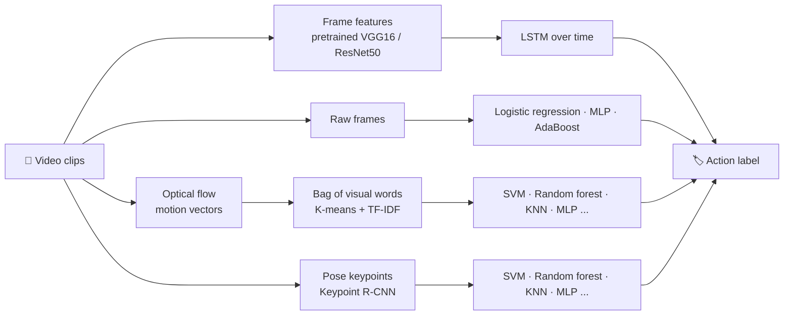

# 🎬 Human Action Recognition: Classical ML vs. Deep Learning


**Can a computer tell what a person is doing in a video, and does it need deep learning to do it?**

This project compares four ways of recognizing human actions in video, from simple models on raw pixels to deep networks, on two benchmark datasets. Every approach is measured on the same footing: **accuracy, computing cost and how interpretable the result is**. Those trade-offs matter when choosing a model for a real system, such as video surveillance, health monitoring or robotics.

It builds on a team project for COMP 6321 (Machine Learning) at Concordia University. I have since rebuilt it as a reusable pipeline and extended it to a new, harder dataset.

---

## ✨ Highlights

- **4 approaches, one framework:** raw-pixel classifiers, motion features (optical flow), human-pose features, and a CNN-LSTM deep network.
- **2 datasets:** KTH (lab-recorded, 6 actions) and UCF101 (real YouTube videos, 5-action subset).
- **Fair evaluation:** official subject and group splits, so the same person or scene never appears in both training and testing.
- **Reproducible:** command-line scripts with cached intermediate results, runnable on a laptop (tested on Apple Silicon).
- **Modernized:** converted from notebooks to scripts, fixed evaluation issues in the original code, and replaced a GPU-only pose model with one that runs on CPU, CUDA or Apple Silicon.

## 🧭 How it works



| Approach | What the model sees | Interpretable? |
|---|---|---|
| **Raw frames** | Pixels of individual frames; each video is labelled by a vote over its frames | Partly: learned weights can be shown as images |
| **Optical flow + bag of visual words** | How things move between frames, summarized as a histogram of typical motion patterns | Yes: motion patterns can be inspected |
| **Pose keypoints** | The positions of 13 body joints in each frame | Yes: joints have a physical meaning |
| **CNN-LSTM** | Deep features of every frame, modelled over time | No: a black box |

### 🎞️ The datasets

**KTH**: 25 people perform 6 actions against plain backgrounds, filmed with a static camera.


**UCF101** (5-action subset): real YouTube videos with moving cameras, cluttered scenes and very different settings per action.


### 👀 What each approach sees

The same test frame, as seen by each classical pipeline: the raw frame shrunk to 60×80 pixels, the optical-flow vectors sampled on a 12×16 grid, and the 13 body keypoints found by Keypoint R-CNN. The CNN-LSTM sees full 120×160 frames.


## 📊 Results

### UCF101 (new experiments)

5 actions (CricketShot, PlayingCello, Punch, ShavingBeard, TennisSwing), official split 1: 594 training and 224 test videos. Random guessing would score 20%.

| Approach | Best model | Test accuracy | Status |
|---|---|---|---|
| Raw frames | Logistic regression | 53.1% | ✅ |
| Optical flow + bag of visual words | Random forest | 70.5% | ✅ |
| Pose keypoints | MLP (1 layer) | 75.9% | ✅ |
| CNN-LSTM | **VGG16-LSTM** | **91.1%** | ✅ |

**Runtime** on a MacBook Pro (Apple M4 Pro, 24 GB). Pose extraction uses the GPU (PyTorch MPS); everything else runs on the CPU, including TensorFlow.

| Approach | Feature extraction | Training (all models, incl. hyperparameter search) | Best model alone |
|---|---|---|---|
| Raw frames | under a minute | ~20 min (almost all AdaBoost) | 3 s |
| Optical flow + bag of visual words | ~4 min flow + ~17 min K-means | ~10 min | 1 s |
| Pose keypoints | ~2.1 h (GPU) | ~1.1 h | 7 min |
| CNN-LSTM | – (frozen VGG16 runs inside training) | 2.2 h for 12 epochs + 4 min test | 2.2 h |

Times are wall-clock with the periods the laptop was asleep removed, so they are approximate. The pose-keypoint MLPs shared the CPU with the CNN-LSTM, so both are slightly slower than they would be alone.

**Where each approach goes wrong**: normalized confusion matrices of each approach's best model on the test set (rows: true action, columns: predicted). Optical flow and pose both send many TennisSwing videos to CricketShot; the CNN-LSTM, which sees the court, almost never does.


### KTH (team course project)

6 actions (boxing, hand clapping, hand waving, jogging, running, walking), 25 people.

| Approach | Best model | Test accuracy |
|---|---|---|
| Raw frames | MLP (2 layers) | 41.5% |
| Optical flow + bag of visual words | Linear SVM | 85.7% |
| Pose keypoints | MLP (3 layers) | 85.7% |
| CNN-LSTM | **VGG16-LSTM** | **88.0%** |

## 💡 Key findings

- **Good features close most of the gap to deep learning, on clean video.** On KTH, motion and pose features lifted simple classifiers from about 41% to about 86%, within 2–3 points of the best deep network. On UCF101 the gap is wider: the VGG16-LSTM reaches 91.1%, 15 points above the best classical model (pose, 75.9%).
- **Motion beats appearance, until two actions move alike.** On UCF101, optical flow beats raw frames (70.5% vs 53.1%) and recognizes Punch and ShavingBeard well (92% and 86% of test videos correct). But it confuses TennisSwing with CricketShot: both are one big swinging arc. Telling them apart needs to *see* the scene (a court or a pitch, a racket or a bat), which is what the CNN-LSTM adds.
- **Pose is the strongest classical feature on real video, with the same blind spot.** Body keypoints reach 75.9% on UCF101 (1-layer MLP; polynomial SVM 71.9%), ahead of optical flow. Pose is strong on ShavingBeard and PlayingCello (93% and 89%), but 25 of the 98 TennisSwing and CricketShot test videos are mistaken for each other: the body moves the same way in both, so the joints alone cannot separate them.
- **Seeing the scene resolves it.** The VGG16-LSTM, which looks at every frame's appearance, gets TennisSwing right 98% of the time and mixes up only 10 of the 98 TennisSwing and CricketShot test videos (25 with pose). Its remaining errors are mostly CricketShot predicted as TennisSwing (9 of 49).
- **Real-world video is much harder than lab video.** The same optical-flow pipeline scores 85.7% on KTH (static camera, plain background) and 70.5% on UCF101 (moving cameras, cluttered scenes).
- **Compute cost moves rather than disappears.** Classical models train in seconds, but pose extraction and deep features need a GPU or hours of CPU time.

## 🚧 Project status

- [x] Convert the original notebooks into a reusable, tested command-line pipeline
- [x] Support several datasets (KTH, UCF101) with official splits
- [x] UCF101: raw-frame baseline and optical flow + bag of visual words
- [x] UCF101: pose keypoints (torchvision Keypoint R-CNN)
- [x] UCF101: CNN-LSTM
- [ ] KTH: rerun the full pipeline on the original data and compare with the course project results
- [ ] Next: compare with a modern video foundation model, fine-tuned with few labels

## 🗂️ Repository structure

```
scripts/
  common.py                          # dataset index, splits, metrics, plotting
  divide_sequences.py                # KTH: split raw videos into action sequences
  extract_frames.py                  # frames for the raw-frame baseline
  train_baseline.py                  # raw-frame classifiers + video-level voting
  train_optical_flow.py              # optical flow + bag of visual words + classifiers
  extract_keypoints_torchvision.py   # body keypoints with torchvision (CPU / CUDA / Apple Silicon)
  extract_keypoints.sh               # body keypoints with Detectron2 (original setup)
  prepare_keypoints.py               # keypoints -> fixed-length pose sequences
  train_keypoints.py                 # classifiers on pose sequences
  train_cnn_lstm.py                  # VGG16-LSTM or ResNet50-LSTM
```

Every script prints its metrics and saves confusion matrices, training curves and models to `outputs/<dataset>/`. Run any script with `--help` for its options.

## ▶️ Quick start

```bash
python -m venv .venv && source .venv/bin/activate
pip install -r requirements.txt

# Data
#   KTH:    videos and 00sequences.txt from https://www.csc.kth.se/cvap/actions/ into data/kth/
#   UCF101: train/, test/, train.csv, test.csv into data/ucf101/
python scripts/divide_sequences.py --raw data/kth/videos --sequences data/kth/00sequences.txt   # KTH only

# Pick a dataset: kth or ucf101
python scripts/extract_frames.py --dataset ucf101 --frame-step 5
python scripts/train_baseline.py --dataset ucf101 --video-agg vote

python scripts/train_optical_flow.py --dataset ucf101

python scripts/extract_keypoints_torchvision.py --dataset ucf101 --frame-step 3
python scripts/prepare_keypoints.py --dataset ucf101
python scripts/train_keypoints.py --dataset ucf101

python scripts/train_cnn_lstm.py --dataset ucf101 --backbone vgg16 --split official --frame-step 4 --max-frames 60
```

<details>
<summary><b>Notes on the original course code and what changed</b></summary>

<br>

The scripts are a rewrite of the original course notebooks. The methods and hyperparameter searches are the same, with these changes:

- **Rebuilt missing steps.** Splitting KTH videos into sequences and building the pose dataset were rebuilt from the project report, because the original pre-processed data is no longer available.
- **Evaluation fixes.** The original frame extraction put one KTH subject in both validation and test sets and left another out. Frame-to-video grouping assumed a fixed file order, one model section evaluated the wrong model, the optical-flow evaluation accumulated predictions across models, and one KNN search ignored its weighting setting. All of these are fixed.
- **Current libraries.** Updated for Python 3.12, scikit-learn 1.8+ and TensorFlow 2.21 (for example, random forest `max_features="auto"`, removed from scikit-learn, is replaced by its equivalent `"sqrt"`).
- **Fairer deep-learning split.** The original CNN-LSTM split videos at random, so the same person could appear in training and test. `--split official` uses the dataset's own split instead.
- **Portable pose extraction.** `extract_keypoints_torchvision.py` uses torchvision's Keypoint R-CNN (ResNet-50) rather than Detectron2's (ResNet-101), so it runs without a dedicated GPU.

Because of these fixes, rerunning on KTH will not reproduce the course project numbers exactly. The KTH table above is from the original project report.

</details>

## 📚 References

- C. Schüldt, I. Laptev and B. Caputo, "Recognizing human actions: a local SVM approach," *ICPR*, 2004. ([KTH dataset](https://www.csc.kth.se/cvap/actions/))
- K. Soomro, A. R. Zamir and M. Shah, "UCF101: A dataset of 101 human actions classes from videos in the wild," *arXiv:1212.0402*, 2012.

## 👩‍💻 Author

**Ornela Bregu**, PhD in Information Systems Engineering (Concordia University) · [LinkedIn](https://linkedin.com/in/ornelabregu)
