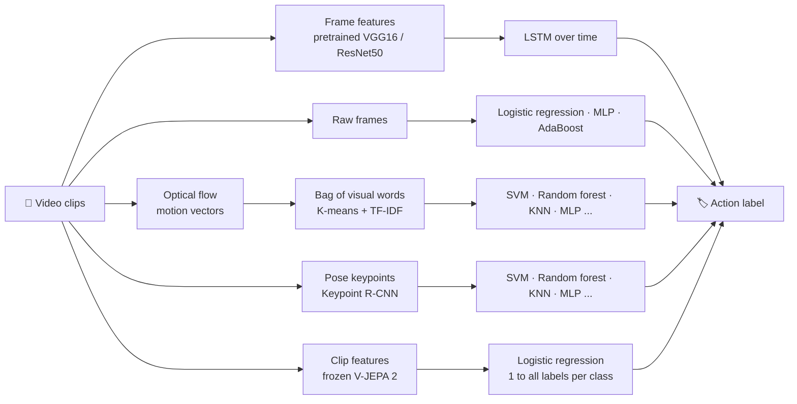
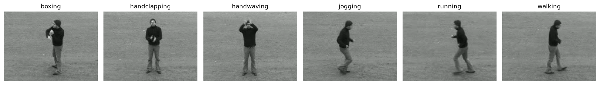
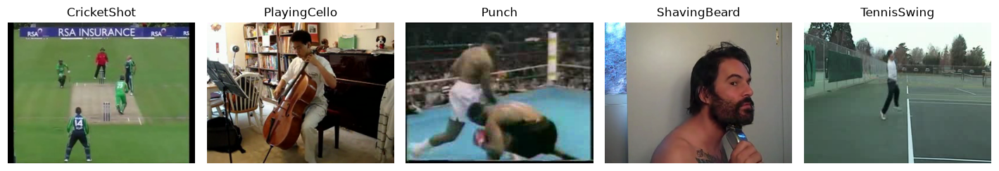
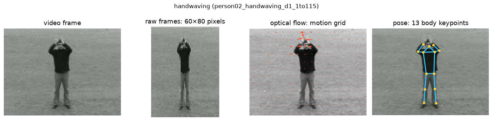
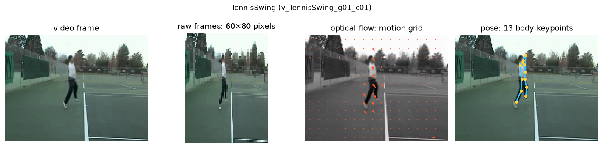
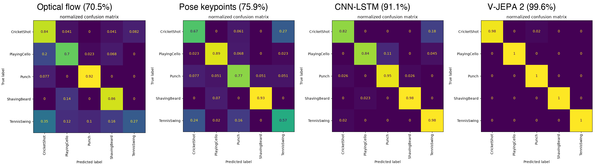
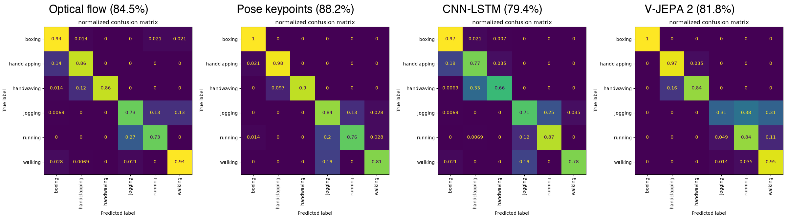
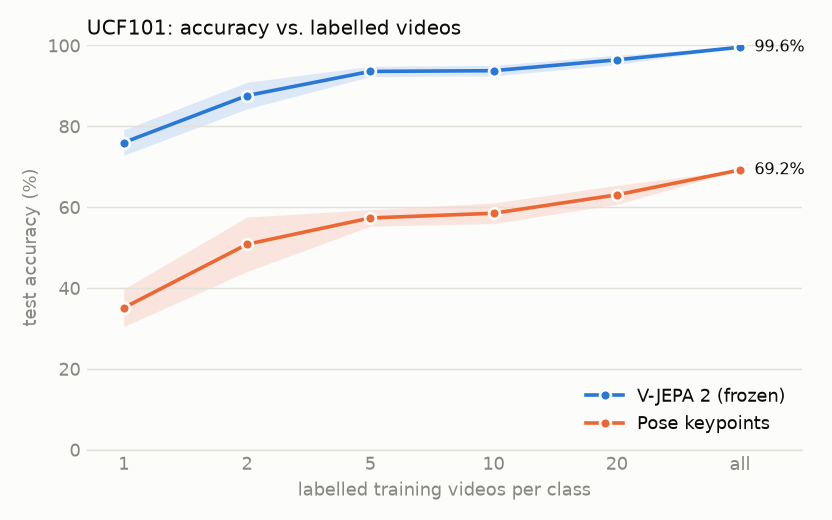
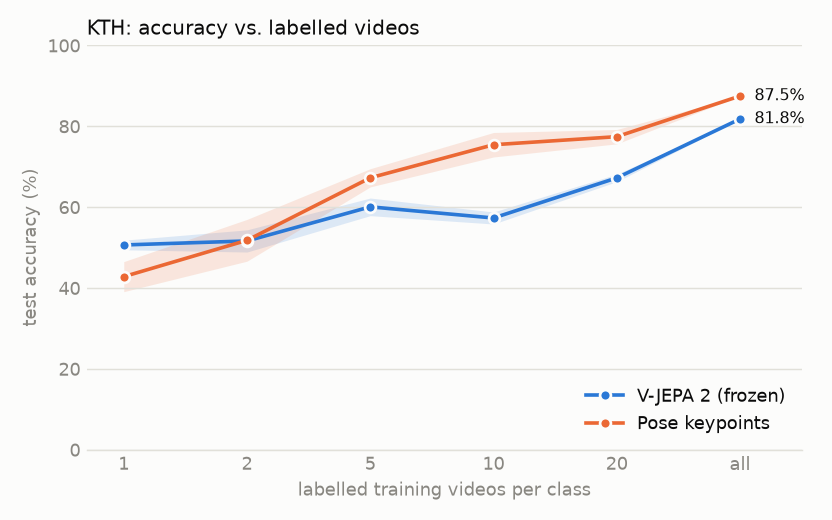

# 🎬 Human Action Recognition: Classical ML vs. Deep Learning


**Can a computer tell what a person is doing in a video, and does it need deep learning to do it?**

This project compares four ways of recognizing human actions in video, from simple models on raw pixels to deep networks, on two benchmark datasets, and then tests a modern video foundation model that learns from only a few labelled videos. Every approach is measured on the same footing: **accuracy, computing cost and how interpretable the result is**. Those trade-offs matter when choosing a model for a real system, such as video surveillance, health monitoring or robotics.

It builds on a team project for COMP 6321 (Machine Learning) at Concordia University. I have since rebuilt it as a reusable pipeline and extended it to a new, harder dataset.

---

## ✨ Highlights

- **4 approaches, one framework:** raw-pixel classifiers, motion features (optical flow), human-pose features, and a CNN-LSTM deep network.
- **2 datasets:** KTH (lab-recorded, 6 actions) and UCF101 (real YouTube videos, 5-action subset).
- **A foundation model with few labels:** Meta's V-JEPA 2, frozen, against the best classical features, from 1 labelled video per class upwards.
- **Fair evaluation:** official subject and group splits, so the same person or scene never appears in both training and testing.
- **Reproducible:** command-line scripts with cached intermediate results, runnable on a laptop (tested on Apple Silicon).
- **Modernized:** converted from notebooks to scripts, fixed evaluation issues in the original code, and replaced a GPU-only pose model with one that runs on CPU, CUDA or Apple Silicon.

## 🧭 How it works



| Approach | What the model sees | Interpretable? |
|---|---|---|
| **Raw frames** | Pixels of individual frames; each video is labelled by a vote over its frames | Partly: learned weights can be shown as images |
| **Optical flow + bag of visual words** | How things move between frames, summarized as a histogram of typical motion patterns | Yes: motion patterns can be inspected |
| **Pose keypoints** | The positions of 13 body joints in each frame | Yes: joints have a physical meaning |
| **CNN-LSTM** | Deep features of every frame, modelled over time | No: a black box |
| **V-JEPA 2 + linear classifier** | Features from a large video transformer pretrained on unlabelled video, averaged over the clip | No: a black box |

### 🎞️ The datasets

**KTH**: 25 people perform 6 actions against plain backgrounds, filmed with a static camera.



**UCF101** (5-action subset): real YouTube videos with moving cameras, cluttered scenes and very different settings per action.



### 👀 What each approach sees

The same test frame, as seen by each classical pipeline: the raw frame shrunk to 60×80 pixels, the optical-flow vectors sampled on a 12×16 grid, and the 13 body keypoints found by Keypoint R-CNN. The CNN-LSTM sees full 120×160 frames.




## 📊 Results

### UCF101 (new experiments)

5 actions (CricketShot, PlayingCello, Punch, ShavingBeard, TennisSwing), official split 1: 594 training and 224 test videos. Random guessing would score 20%.

| Approach | Best model | Test accuracy | Status |
|---|---|---|---|
| Raw frames | Logistic regression | 53.1% | ✅ |
| Optical flow + bag of visual words | Random forest | 70.5% | ✅ |
| Pose keypoints | MLP (1 layer) | 75.9% | ✅ |
| CNN-LSTM | VGG16-LSTM | 91.1% | ✅ |
| Foundation model | **V-JEPA 2 (frozen) + logistic regression** | **99.6%**\* | ✅ |

\* Pretrained on unlabelled video that likely includes footage similar to UCF101; with only 5 labelled videos per class it scores 93.6%. See [the foundation-model section](#-a-video-foundation-model-with-few-labels).

**Runtime** on a MacBook Pro (Apple M4 Pro, 24 GB). Pose extraction and V-JEPA 2 use the GPU (PyTorch MPS); everything else runs on the CPU, including TensorFlow.

| Approach | Feature extraction | Training (all models, incl. hyperparameter search) | Best model alone |
|---|---|---|---|
| Raw frames | under a minute | ~20 min (almost all AdaBoost) | 3 s |
| Optical flow + bag of visual words | ~4 min flow + ~17 min K-means | ~10 min | 1 s |
| Pose keypoints | ~2.1 h (GPU) | ~1.1 h | 7 min |
| CNN-LSTM | – (frozen VGG16 runs inside training) | 2.2 h for 12 epochs + 4 min test | 2.2 h |
| Foundation model (V-JEPA 2) | 9 min (GPU) | seconds | seconds |

Times are wall-clock with the periods the laptop was asleep removed, so they are approximate. The pose-keypoint MLPs shared the CPU with the CNN-LSTM, so both are slightly slower than they would be alone.

**Where each approach goes wrong**: normalized confusion matrices of each approach's best model on the test set (rows: true action, columns: predicted). Optical flow and pose both send many TennisSwing videos to CricketShot; the CNN-LSTM, which sees the court, almost never does, and V-JEPA 2 makes a single mistake on all 224 test videos (one CricketShot taken for Punch). Raw frames are left out for readability.



### KTH (rerun vs. course project)

6 actions (boxing, hand clapping, hand waving, jogging, running, walking), 25 people, official subject split: 1,528 training and validation videos (16 people) and 863 test videos (9 other people). Random guessing would score 16.7%.

| Approach | Course project: best model | Course project | Rerun: best model | Rerun | Change |
|---|---|---|---|---|---|
| Raw frames | MLP (2 layers) | 41.5% | Logistic regression | 35.2% | −6.3 |
| Optical flow + bag of visual words | Linear SVM | 85.7% | MLP (1 layer) | 84.5% | −1.2 |
| Pose keypoints | MLP (3 layers) | 85.7% | **MLP (2 layers)** | **88.2%** | +2.5 |
| CNN-LSTM | **VGG16-LSTM** | **88.0%** | VGG16-LSTM | 79.4% | −8.6 |
| Foundation model | – | – | V-JEPA 2 (frozen) + logistic regression | 81.8% | new |

**Why the numbers changed.** The rerun uses the same methods and hyperparameter searches as the course project, but fixes how they are evaluated and fits on a 24 GB laptop:

- **CNN-LSTM (−8.6): a fair split.** The course project split videos at random, so the same people appeared in training and test. The rerun tests on 9 people the model has never seen. The model's own validation set, drawn from the training people, still scores 92–94%, while unseen people score 79%: that gap suggests most of the drop comes from the model having partly learned the people rather than the actions. To fit in memory, the rerun also reads every 2nd frame, up to 60 frames (about 5 seconds), instead of the first 250 frames, so part of the gap may come from that. Its errors are all between similar actions: hand waving taken for hand clapping (33%), jogging for running (25%) and walking for jogging (19%).
- **Pose keypoints (+2.5): a rebuilt pipeline.** The course project's pose data was lost and the step that built it was rebuilt from the report. Keypoints now come from torchvision's Keypoint R-CNN (ResNet-50) on every 3rd frame, instead of Detectron2's (ResNet-101). Despite the smaller model, pose is now the best approach on KTH; 6 of its models score above 85% (logistic regression 88.1%, polynomial SVM 87.5%).
- **Optical flow (−1.2): essentially reproduced.** The original evaluation accumulated predictions across models; with that fixed, the best models land within about 1.5 points of the course result (linear SVM 84.0%, MLP 84.5%).
- **Raw frames (−6.3): a fixed split and a collapsed MLP.** The original frame extraction put one person in both validation and test and left another out, and video labels were the rounded mean of frame predictions instead of a majority vote. The rerun also uses every 2nd frame to fit in memory. With the course's fixed settings (SGD, learning rate 0.01, momentum 0.9, 10 iterations) the 2-layer MLP never started learning and predicts a single class (16.7%), so logistic regression (35.2%) is the best raw-frame model; AdaBoost scores 33.0%.

**Runtime** (same laptop and conditions as for UCF101):

| Approach | Feature extraction | Training (all models, incl. hyperparameter search) | Best model alone |
|---|---|---|---|
| Raw frames | 16 s | 43 min (AdaBoost 40 min of it) | 20 s |
| Optical flow + bag of visual words | ~4 min flow + ~9 min K-means | ~8 min | 7 min |
| Pose keypoints | 1.7 h (GPU) | ~1.1 h | ~16 min |
| CNN-LSTM | – (frozen VGG16 runs inside training) | 4.9 h for 12 epochs + 14 min test | 5.2 h |
| Foundation model (V-JEPA 2) | 23 min (GPU) | seconds | seconds |

The pose-keypoint MLPs ran partly while the laptop slept, so their times are estimates. The raw-frame baseline peaked at 14.4 GB of memory and the CNN-LSTM at 15.6 GB.

**Where each approach goes wrong** (normalized confusion matrices, best model per approach). Every approach mixes up jogging and running. The CNN-LSTM also confuses hand waving with hand clapping, which pose separates well. V-JEPA 2 is near-perfect on the arm actions but gets only 31% of jogging videos right, splitting the rest between running and walking. Raw frames are left out for readability.



### 🧠 A video foundation model with few labels

Can a model pretrained on millions of unlabelled videos recognize these actions from just a handful of examples? [V-JEPA 2](https://arxiv.org/abs/2506.09985) (Meta, 2025; ViT-L, 300M parameters) is kept frozen: each video is encoded once (16 frames spread over the clip, full frame resized to 256×256) and its features are averaged. A logistic regression is then trained on *k* labelled training videos per class and tested on the full official test set. Each budget is drawn 5 times at random, and pose keypoints, the best classical features, are given exactly the same draws. The classifier is not tuned at any budget (there is nothing to tune it on with one video per class), which is why pose with all labels scores slightly below its tuned results above.

| Labelled videos per class | UCF101: V-JEPA 2 | UCF101: pose | KTH: V-JEPA 2 | KTH: pose |
|---|---|---|---|---|
| 1 | **76.0 ± 3.1%** | 35.1 ± 4.6% | **50.6 ± 1.2%** | 42.8 ± 3.7% |
| 2 | **87.6 ± 3.3%** | 50.8 ± 6.7% | 51.6 ± 2.7% | 51.8 ± 5.2% |
| 5 | **93.6 ± 1.3%** | 57.3 ± 2.0% | 60.1 ± 2.2% | **67.3 ± 2.3%** |
| 10 | **93.8 ± 1.3%** | 58.5 ± 2.6% | 57.3 ± 1.5% | **75.4 ± 3.0%** |
| 20 | **96.4 ± 1.2%** | 63.0 ± 2.4% | 67.2 ± 0.9% | **77.4 ± 1.8%** |
| all (594 / 1,528 videos) | **99.6%** | 69.2% | 81.8% | **87.5%** |
| *Best earlier result, all labels* | *CNN-LSTM 91.1%* | | *Pose MLP 88.2%* | |

<p>
  
  
</p>

**On UCF101 the foundation model wins easily.** With 5 labelled videos per class it beats every earlier approach trained on all 594 videos, and with one video per class it already matches the best classical model trained on everything. **One caveat:** V-JEPA 2 was pretrained on unlabelled video that includes about 733,000 Kinetics clips and 19 million YouTube videos. Kinetics has closely related actions (playing cello, playing cricket, punching, playing tennis) and UCF101's clips also come from YouTube, so the model has very likely seen footage much like these test videos, and possibly some of the same ones.

**On KTH, which is not among its pretraining sources, pose wins from 5 labels up.** V-JEPA 2 is near-perfect on the arm actions (boxing 100%, hand clapping 97% with all labels) but recognizes only 31% of jogging videos, splitting them between jogging, running and walking. The likely reason is this setup rather than the model: 16 frames spread over clips of different lengths, then averaged over time, keep *what* the person looks like but blur *how fast* they move, which is exactly what separates the three leg actions. Pose sequences keep the timing.

**Runtime:** encoding every video takes 9 minutes for UCF101 and 23 minutes for KTH on the laptop GPU (one pass, no training), and each classifier trains in seconds: about as fast as the optical-flow pipeline, and much faster than pose extraction or the CNN-LSTM.

## 💡 Key findings

- **Deep learning wins on real video, not on lab video.** On KTH, with a fair split by person, pose features with a small MLP (88.2%) beat the VGG16-LSTM (79.4%). On UCF101 the order flips: the VGG16-LSTM reaches 91.1%, 15 points above the best classical model (pose, 75.9%). In both datasets, motion and pose features lift simple classifiers far above raw pixels (35–53%).
- **A leaky split flatters the deep model most.** The course project's random KTH split put the same people in training and test and gave the VGG16-LSTM 88.0%; tested on unseen people it scores 79.4%, while optical flow and pose moved by less than 3 points (see the KTH comparison above).
- **Motion beats appearance, until two actions move alike.** On UCF101, optical flow beats raw frames (70.5% vs 53.1%) and recognizes Punch and ShavingBeard well (92% and 86% of test videos correct). But it confuses TennisSwing with CricketShot: both are one big swinging arc. Telling them apart needs to *see* the scene (a court or a pitch, a racket or a bat), which is what the CNN-LSTM adds.
- **Pose is the strongest classical feature on real video, with the same blind spot.** Body keypoints reach 75.9% on UCF101 (1-layer MLP; polynomial SVM 71.9%), ahead of optical flow. Pose is strong on ShavingBeard and PlayingCello (93% and 89%), but 25 of the 98 TennisSwing and CricketShot test videos are mistaken for each other: the body moves the same way in both, so the joints alone cannot separate them.
- **Seeing the scene resolves it.** The VGG16-LSTM, which looks at every frame's appearance, gets TennisSwing right 98% of the time and mixes up only 10 of the 98 TennisSwing and CricketShot test videos (25 with pose). Its remaining errors are mostly CricketShot predicted as TennisSwing (9 of 49).
- **Real-world video is much harder than lab video.** The same optical-flow pipeline scores 84.5% on KTH (static camera, plain background) and 70.5% on UCF101 (moving cameras, cluttered scenes).
- **A foundation model needs far fewer labels, where it has seen similar video.** Frozen V-JEPA 2 features reach 93.6% on UCF101 with 5 labelled videos per class, above the CNN-LSTM trained on all 594, but on lab-recorded KTH they lose to pose keypoints from 5 labels up (81.8% vs 87.5% with all labels), most likely because averaging its features over time loses the speed that separates jogging from running and walking.
- **Compute cost moves rather than disappears.** The best classical models train in seconds to minutes once features exist, but pose extraction takes about 2 hours on a laptop GPU, and the CNN-LSTM trains for 2.2 hours (UCF101) to 5 hours (KTH) on CPU. The frozen foundation model is the cheapest strong option: one 9–23 minute encoding pass on the GPU, then seconds per classifier.

## 🚧 Project status

- [x] Convert the original notebooks into a reusable, tested command-line pipeline
- [x] Support several datasets (KTH, UCF101) with official splits
- [x] UCF101: raw-frame baseline and optical flow + bag of visual words
- [x] UCF101: pose keypoints (torchvision Keypoint R-CNN)
- [x] UCF101: CNN-LSTM
- [x] KTH: rerun the full pipeline on the original data and compare with the course project results
- [x] Compare with a modern video foundation model (V-JEPA 2, frozen) with few labels
- [ ] Next: keep V-JEPA 2's timing (fixed frame rate, per-time-step features or an attentive probe) and fine-tune the encoder, to close the KTH gap

## 🗂️ Repository structure

```
scripts/
  common.py                          # dataset index, splits, metrics, plotting
  divide_sequences.py                # KTH: split raw videos into action sequences
  extract_frames.py                  # frames for the raw-frame baseline
  train_baseline.py                  # raw-frame classifiers + video-level voting
  train_optical_flow.py              # optical flow + bag of visual words + classifiers
  extract_keypoints_torchvision.py   # body keypoints with torchvision (CPU / CUDA / Apple Silicon)
  extract_keypoints.sh               # body keypoints with Detectron2 (original setup)
  prepare_keypoints.py               # keypoints -> fixed-length pose sequences
  train_keypoints.py                 # classifiers on pose sequences
  train_cnn_lstm.py                  # VGG16-LSTM or ResNet50-LSTM
  extract_video_features.py          # frozen V-JEPA 2 features (CPU / CUDA / Apple Silicon)
  train_few_shot.py                  # V-JEPA 2 vs. pose with 1, 2, 5, 10, 20 or all labels per class
```

Every script prints its metrics and saves confusion matrices, training curves and models to `outputs/<dataset>/`. Run any script with `--help` for its options.

## ▶️ Quick start

```bash
python -m venv .venv && source .venv/bin/activate
pip install -r requirements.txt

# Data
#   KTH:    videos and 00sequences.txt from https://www.csc.kth.se/cvap/actions/ into data/kth/
#   UCF101: train/, test/, train.csv, test.csv into data/ucf101/
python scripts/divide_sequences.py --raw data/kth/videos --sequences data/kth/00sequences.txt   # KTH only

# Pick a dataset: kth or ucf101
python scripts/extract_frames.py --dataset ucf101 --frame-step 5
python scripts/train_baseline.py --dataset ucf101 --video-agg vote

python scripts/train_optical_flow.py --dataset ucf101

python scripts/extract_keypoints_torchvision.py --dataset ucf101 --frame-step 3
python scripts/prepare_keypoints.py --dataset ucf101
python scripts/train_keypoints.py --dataset ucf101

python scripts/train_cnn_lstm.py --dataset ucf101 --backbone vgg16 --split official --frame-step 4 --max-frames 60

python scripts/extract_video_features.py --dataset ucf101    # downloads V-JEPA 2 (1.3 GB) on first use
python scripts/train_few_shot.py --dataset ucf101           # needs the pose keypoints above
```

<details>
<summary><b>Notes on the original course code and what changed</b></summary>

<br>

The scripts are a rewrite of the original course notebooks. The methods and hyperparameter searches are the same, with these changes:

- **Rebuilt missing steps.** Splitting KTH videos into sequences and building the pose dataset were rebuilt from the project report, because the original pre-processed data is no longer available.
- **Evaluation fixes.** The original frame extraction put one KTH subject in both validation and test sets and left another out. Frame-to-video grouping assumed a fixed file order, one model section evaluated the wrong model, the optical-flow evaluation accumulated predictions across models, and one KNN search ignored its weighting setting. All of these are fixed.
- **Current libraries.** Updated for Python 3.12, scikit-learn 1.8+ and TensorFlow 2.21 (for example, random forest `max_features="auto"`, removed from scikit-learn, is replaced by its equivalent `"sqrt"`).
- **Fairer deep-learning split.** The original CNN-LSTM split videos at random, so the same person could appear in training and test. `--split official` uses the dataset's own split instead.
- **Portable pose extraction.** `extract_keypoints_torchvision.py` uses torchvision's Keypoint R-CNN (ResNet-50) rather than Detectron2's (ResNet-101), so it runs without a dedicated GPU.

Because of these fixes, rerunning on KTH will not reproduce the course project numbers exactly. The KTH comparison above lists both.

</details>

## 📚 References

- C. Schüldt, I. Laptev and B. Caputo, "Recognizing human actions: a local SVM approach," *ICPR*, 2004. ([KTH dataset](https://www.csc.kth.se/cvap/actions/))
- K. Soomro, A. R. Zamir and M. Shah, "UCF101: A dataset of 101 human actions classes from videos in the wild," *arXiv:1212.0402*, 2012.
- M. Assran et al., "V-JEPA 2: Self-supervised video models enable understanding, prediction and planning," *arXiv:2506.09985*, 2025.

## 👩‍💻 Author

**Ornela Bregu**, PhD in Information Systems Engineering (Concordia University) · [LinkedIn](https://linkedin.com/in/ornelabregu)
